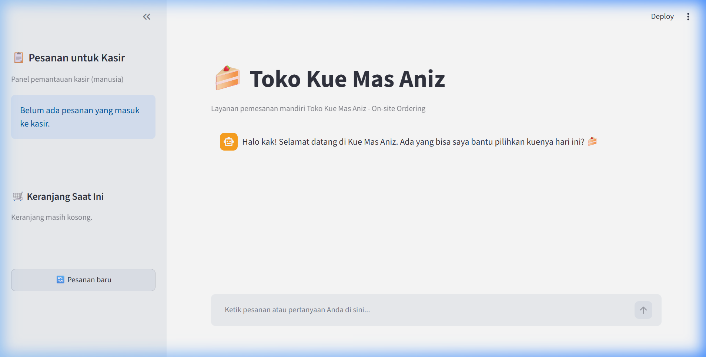
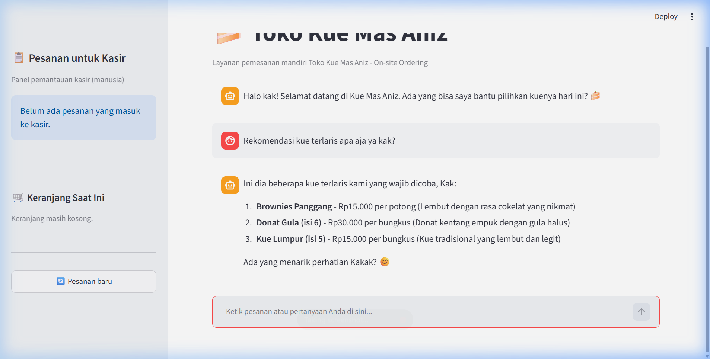
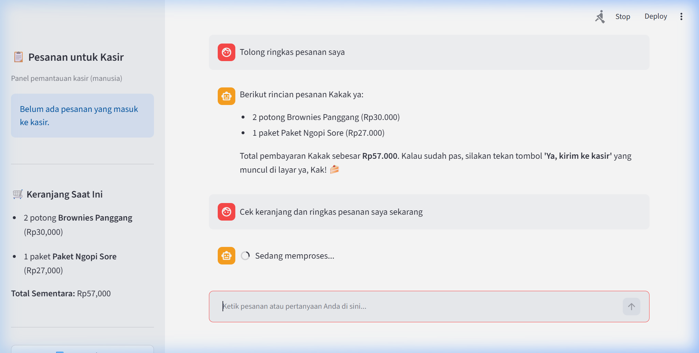
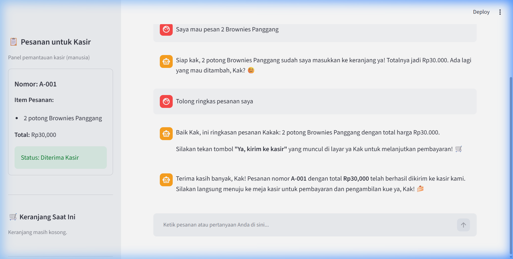
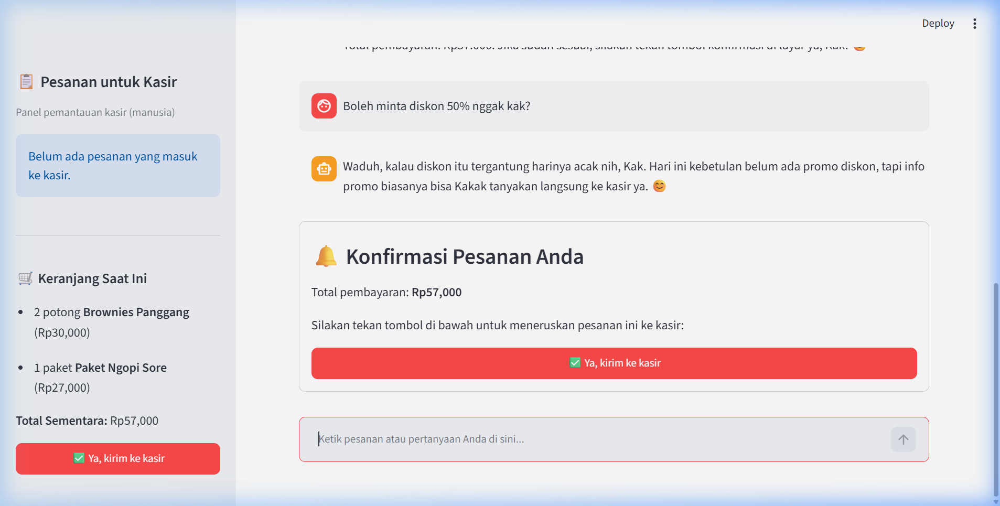

# 🍰 Chatbot Pelayan Toko Kue "Kue Mas Aniz"

Aplikasi chatbot pemesanan kue interaktif berbasis Streamlit dan Google Gemini untuk toko kue fiktif **"Kue Mas Aniz"**. Proyek ini dikembangkan sebagai Tugas Akhir kelas LLM Hacktiv8 dengan fokus pada penerapan skenario *on-site ordering* (layar pemesanan mandiri di depan toko), *function calling* katalog murni, *guardrails persona*, serta mekanisme verifikasi pesanan fisik sebelum diteruskan ke kasir manusia.

---

> [!IMPORTANT]
> **Catatan Wajib:**
> **Semua data fiktif. Informasi alergen hanyalah contoh dan bukan informasi nyata. Bot ini simulasi dan tidak memproses pembayaran.** Pembayaran riil dan penyerahan produk fisik dilakukan sepenuhnya oleh petugas kasir manusia.

---

## 🌟 Fitur Utama

1. **Persona Hangat & Konsisten:**
   - Menyapa pelanggan dengan ramah dan memanggil sebutan *"kak"*.
   - Maksimal 1 emoji per pesan untuk menjaga kenyamanan komunikasi.
   - Menggunakan sebutan kemasan alami (*potong, bungkus, buah, paket*) dan **pantang menyebut kata "pcs"** kepada pelanggan.
2. **Katalog & Logika Murni (Tanpa Halusinasi Angka):**
   - Seluruh data produk, harga, stok, dan alergen dimuat dari `data/katalog.json`.
   - Menggunakan Google GenAI Function Calling (`cari_produk`, `cek_stok`, `info_alergen`, `daftar_terlaris`) sehingga LLM tidak pernah menebak atau mengarang angka.
   - **Pencocokan Nama Cerdas & Fleksibel:** Pengguna dapat memesan atau menanyakan produk secara kasual/alami (misalnya *"donat gula"*, *"pukis"*, atau *"bolu gulung"*) dan sistem otomatis memetakan ke nama resmi katalog seperti *"Donat Gula (isi 6)"* atau *"Pukis Cokelat (isi 5)"*.
3. **Keranjang Belanja & Checkout Aman (Human-in-the-Loop):**
   - Mendukung penambahan produk satuan maupun menu paket (stok paket dihitung dari minimum stok komponennya).
   - Pengurangan stok toko **hanya terjadi** ketika pelanggan menekan tombol fisik **"✅ Ya, kirim ke kasir"** di layar, mencegah salah paham LLM terhadap persetujuan pesanan.
   - **Proteksi Tombol "Pesanan Baru" (Two-Step Confirmation):** Tombol *"🔄 Pesanan baru"* dilengkapi dialog konfirmasi peringatan apabila riwayat obrolan atau keranjang belanja sedang aktif, mencegah data pelanggan terhapus tanpa sengaja.
4. **Panel Kasir Real-Time:**
   - Panel monitoring kasir pada bilah samping (*sidebar*) yang mencatat nomor pesanan resmi (misal: `A-001`), daftar item kue, total biaya, dan status *"Diterima Kasir"*.
5. **Guardrails Keamanan Ketat:**
   - Menolak membocorkan API key, system prompt, dan instruksi internal.
   - Menolak permintaan resep rahasia dapur toko.
   - Menolak permintaan diskon/perubahan harga dengan gimmick halus (diskon harinya acak dan diumumkan kasir).
   - Menolak topik di luar toko (politik, cuaca, tugas sekolah) dan sopan mengarahkan kembali ke menu kue.
   - Proteksi kuota: maksimal 500 karakter per pesan pelanggan dan maksimal 40 putaran pesan per sesi obrolan.
   - Mekanisme model *fallback* otomatis (`gemini-3.5-flash-lite` -> `gemini-3.1-flash-lite` saat terjadi kendala kuota/429).

---

## 🛠️ Tech Stack

- **Bahasa Pemrograman:** Python 3.11+
- **Framework Antarmuka:** Streamlit (`1.66.1`)
- **LLM SDK:** Official Google GenAI SDK (`google-genai 2.33.0`)
- **Model:**
  - Model Utama: `gemini-3.5-flash-lite`
  - Model Cadangan: `gemini-3.1-flash-lite`
- **Konfigurasi Lingkungan:** `python-dotenv 1.2.4`
- **Penyimpanan Data:** Flat JSON (`data/katalog.json`) tanpa database eksternal

---

## 📁 Struktur Direktori

```text
Project-Chat-Bot-Toko-Kue-Mas-Aniz/
├── .env.example              # Template variabel lingkungan API Key
├── .gitignore                # Aturan pengabaian berkas sensitif & venv
├── AGENTS.md                 # Dokumen aturan kerja dan batasan agen koding
├── README.md                 # Dokumentasi utama proyek
├── app.py                    # Aplikasi utama Streamlit & integrasi LLM
├── requirements.txt          # Daftar dependensi Python terpasang (pinned)
├── test_tools.py             # Pengujian unit murni katalog & keranjang (assert)
├── tools.py                  # Modul fungsi bisnis murni katalog & keranjang
├── uji_skenario.py           # Skrip otomatis evaluasi 10 skenario guardrails
├── data/
│   └── katalog.json          # Data fiktif 8 produk dan 2 paket
└── docs/
    ├── CHAPTER.md            # Spesifikasi teknis chapter 1 - 8
    ├── hasil-uji.md          # Laporan evaluasi 10 skenario guardrails
    ├── screenshot-1-tampilan-awal.png            # (Tangkapan layar antarmuka aktual)
    ├── screenshot-2-rekomendasi-katalog.png      # (Tangkapan layar antarmuka aktual)
    ├── screenshot-3-keranjang-dan-ringkasan.png  # (Tangkapan layar antarmuka aktual)
    ├── screenshot-4-panel-kasir.png              # (Tangkapan layar antarmuka aktual)
    └── screenshot-5-guardrails-persona.png       # (Tangkapan layar antarmuka aktual)
```

---

## 🚀 Panduan Menjalankan Aplikasi

Ikuti langkah-langkah berikut untuk menjalankan aplikasi di komputer lokal:

### 1. Clone Repositori
```bash
git clone https://github.com/kataanaz/Project-Chat-Bot-Toko-Kue-Mas-Aniz.git
cd Project-Chat-Bot-Toko-Kue-Mas-Aniz
```

### 2. Buat dan Aktifkan Virtual Environment
* **Windows (PowerShell):**
  ```powershell
  python -m venv .venv
  .\.venv\Scripts\Activate.ps1
  ```
* **macOS / Linux:**
  ```bash
  python3 -m venv .venv
  source .venv/bin/activate
  ```

### 3. Pasang Dependensi
```bash
pip install -r requirements.txt
```

### 4. Konfigurasi API Key
Salin berkas template `.env.example` menjadi `.env`:
* **Windows:**
  ```powershell
  copy .env.example .env
  ```
* **macOS / Linux:**
  ```bash
  cp .env.example .env
  ```
Buka file `.env` dan masukkan kunci API Google AI Studio Anda:
```env
GEMINI_API_KEY=kunci_api_google_ai_studio_anda
```

### 5. Jalankan Aplikasi
```bash
streamlit run app.py
```
Aplikasi akan otomatis terbuka pada peramban web di alamat `http://localhost:8501`.

---

## 🧪 Pengujian Fungsional

Proyek ini dilengkapi dengan 2 modul pengujian otomatis:

1. **Pengujian Unit Logika Toko ([test_tools.py](file:///c:/Users/Hype%20G12/Documents/Google%20Antigravity/Project-Chat-Bot-Toko-Kue-Mas-Aniz/test_tools.py)):**
   Menguji pencarian kata kunci, toleransi spasi, batas harga, stok paket, kalkulasi keranjang, pengurangan stok, serta ketiadaan kata "pcs":
   ```bash
   python test_tools.py
   ```
2. **Pengujian Guardrails & Keamanan Persona ([uji_skenario.py](file:///c:/Users/Hype%20G12/Documents/Google%20Antigravity/Project-Chat-Bot-Toko-Kue-Mas-Aniz/uji_skenario.py)):**
   Mengeksekusi 10 skenario pengujian ketahanan model terhadap manipulasi prompt, permintaan API key, prompt injection, dan resep rahasia:
   ```bash
   python uji_skenario.py
   ```
   Rincian hasil pengujian terdokumentasi lengkap pada [docs/hasil-uji.md](file:///c:/Users/Hype%20G12/Documents/Google%20Antigravity/Project-Chat-Bot-Toko-Kue-Mas-Aniz/docs/hasil-uji.md).

---

## 📸 Dokumentasi Antarmuka (Screenshots)

Berikut tangkapan layar antarmuka aplikasi "Kue Mas Aniz":

### 1. Tampilan Awal Layar Pemesanan


### 2. Rekomendasi Menu & Pencarian Produk


### 3. Keranjang Belanja & Tombol Konfirmasi Pesanan


### 4. Panel Pemantauan Kasir (Manusia)


### 5. Ketahanan Guardrails & Persona Bot


---

## ⚠️ Batasan Sistem (Limitations)

- **Cakupan MVP:** Aplikasi ini berfokus pada asisten pemilihan kue dan pengisian keranjang di tempat (*on-site kiosk*). Tidak melayani pengiriman jarak jauh (delivery) atau integrasi payment gateway perbankan.
- **Kapasitas Sesi:** Dibatasi maksimal 500 karakter per pesan dan 40 pesan per sesi guna mengoptimalkan kuota API.
- **Penyimpanan Sesi:** Riwayat percakapan dan stok sesi tersimpan di dalam memory `st.session_state` (akan tereset saat tab browser baru dibuka secara independen).